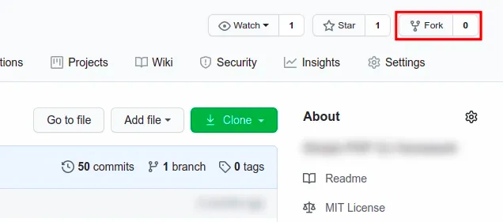
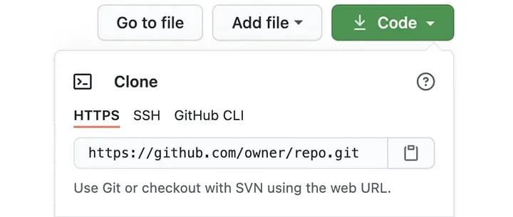

+++
path = "getting-started-with-open-source-software"
title = "Getting started with Open Source Software"
description = "Contribute to an open source project on GitHub step by step: fork and clone the repo, add the upstream remote, keep your fork in sync, open a pull request."
date = 2020-07-02
updated = 2026-11-01
aliases = ['2020-07-02-getting-started-with-open-source-software']

[taxonomies]
tags = ['Collaboration', 'Git', 'Github', 'Open Source', 'Programming']

[extra]
static_thumbnail = "/images/2020-07-02/1.webp"
subtitle = "Being up-to-date and avoiding conflicts"
+++


If you want to collaborate with open-source projects but you don't know how to start, it couldn't be easier. Pick a
project, pick an issue, and follow a handful of git commands.

## Find a project and a first issue

The best first project is one **you already use**: you know what it does, and you have probably hit one of its rough
edges.

Many maintainers label beginner-friendly tasks as **`good first issue`**. You can list them from the terminal with the
[GitHub CLI](https://cli.github.com/):

```bash
# In one repository
gh issue list --repo owner/repo --label "good first issue"
# Open and unassigned, across PHP projects
gh search issues --label "good first issue" --language php --state open --no-assignee
```

Don't underestimate the docs. Fixing a typo or an outdated example in the `README` is a real contribution, and it
teaches you how the project works (CI, reviews, merges) with very little risk.

## Before writing any code

Read the **`CONTRIBUTING.md`** file. It tells you how to run the tests, which coding standard to follow and which
branch to target. Read the **code of conduct** too.

For anything bigger than a small fix, **ask in the issue first**. A short comment with your plan is enough.

> Agreeing on the approach takes a couple of comments. Discovering after 500 lines that the maintainers had already ruled
> it out takes a lot longer, for both sides.

Keep your pull request **small and focused**: one topic per branch. A PR that fixes a bug, renames three classes and
bumps a dependency is hard to review. Split it into three branches.

## From fork to pull request

### 1. Fork the repository into your account



### 2. Clone the forked project on your computer

```bash
git clone git@github.com:myself/forked.git
```

### 3. Add the upstream to sync with the new changes to your project



```bash
(master)$ git remote add upstream https://github.com/owner/repo.git
# If you run `git remote -v` you should see:
origin	git@github.com:myself/forked.git (fetch)
origin	git@github.com:myself/forked.git (push)
upstream	https://github.com/owner/repo.git (fetch)
upstream	https://github.com/owner/repo.git (push)
```

### 4. Create a new branch

```bash
(master)$ git checkout -b new-branch
```

### 5. Commit, push and open the pull request

Once you're done, let's create a PR! Check `git status` first, so your IDE folders (`.idea/`, `.vscode/`) don't end up
in someone else's project. A [global gitignore](/how-to-create-a-global-gitignore-file/) keeps them out of every
repository.

```bash
(new-branch)$ git status # Check what you are about to commit
(new-branch)$ git add . # Add to git your changes
(new-branch)$ git commit -m 'Type the commit message'
(new-branch)$ git push origin new-branch # Push in forked & origin
```

Open your fork on GitHub and click **Compare & pull request**. Explain what you changed and why, and add `Closes #123`
to the description so the issue closes when the PR is merged.

If you cloned with HTTPS and get errors trying to push your last changes, switch `origin` to SSH (you need an SSH key
in your GitHub account):

```bash
(master)$ git remote set-url origin git@github.com:myself/forked.git
```

### Shortcut: the GitHub CLI

With the GitHub CLI, steps 1 to 3 are a single command. It forks the repository, clones your fork as `origin` and adds
the original one as `upstream`:

```bash
gh repo fork owner/repo --clone
```

After committing, `gh pr create` opens the pull request from the terminal. `--fill` takes the title and body from
your commits:

```bash
(new-branch)$ gh pr create --fill
```

## Keep your fork in sync

Other pull requests get merged while you work on yours. Get the last changes in your project before you start a new
branch (not necessary if you just forked the project):

```bash
(master)$ git fetch upstream master
(master)$ git merge upstream/master
(master)$ git push origin master # Update your fork on GitHub too
```

If the upstream moved while your branch was open, rebase your branch on top of it. Rebasing rewrites your commits, so
the push needs `--force-with-lease`. Unlike `--force`, it refuses to overwrite commits on the remote branch that you
haven't fetched yet.

```bash
(new-branch)$ git fetch upstream
(new-branch)$ git rebase upstream/master
(new-branch)$ git push --force-with-lease origin new-branch
```

To move only some of your commits, take a look at [Git Rebase onto](/git-rebase-onto/).

> Many repositories now use `main` instead of `master` as the default branch. Run `git remote show upstream`, look for
> `HEAD branch`, and replace `master` in these commands.

## Handle the review

Maintainers will often ask for changes. Don't open a new PR. Commit the fixes on the same branch and push them, and the
pull request updates by itself.

```bash
(new-branch)$ git add .
(new-branch)$ git commit -m 'Address review comments'
(new-branch)$ git push origin new-branch
```

Reply to each comment so the reviewer knows what changed.

## That's all!

> Every merged pull request, yours or someone else's, moves the original repository forward.
> [Sync your fork](#keep-your-fork-in-sync) before you start your next branch.


## Summary

```bash
# Synchronize your local repository to the original one
# Need to run only once the first time
git remote add upstream https://github.com/owner/repo.git
# Get all changes from sync project into upstream branch
git fetch upstream master
# Merge upstream branch into your current branch
git merge upstream/master
```

Happy contributing! 🚀

<div class="separator"></div>

## Reference

- [Syncing a fork | GitHub doc](https://help.github.com/en/github/collaborating-with-issues-and-pull-requests/syncing-a-fork)
- [gh repo fork | GitHub CLI manual](https://cli.github.com/manual/gh_repo_fork)
- [Learn Git commands | GitExplorer](https://git.gaozih.com/)
- [Git Tips | Oh Shit, Git!?!](https://ohshitgit.com/)
